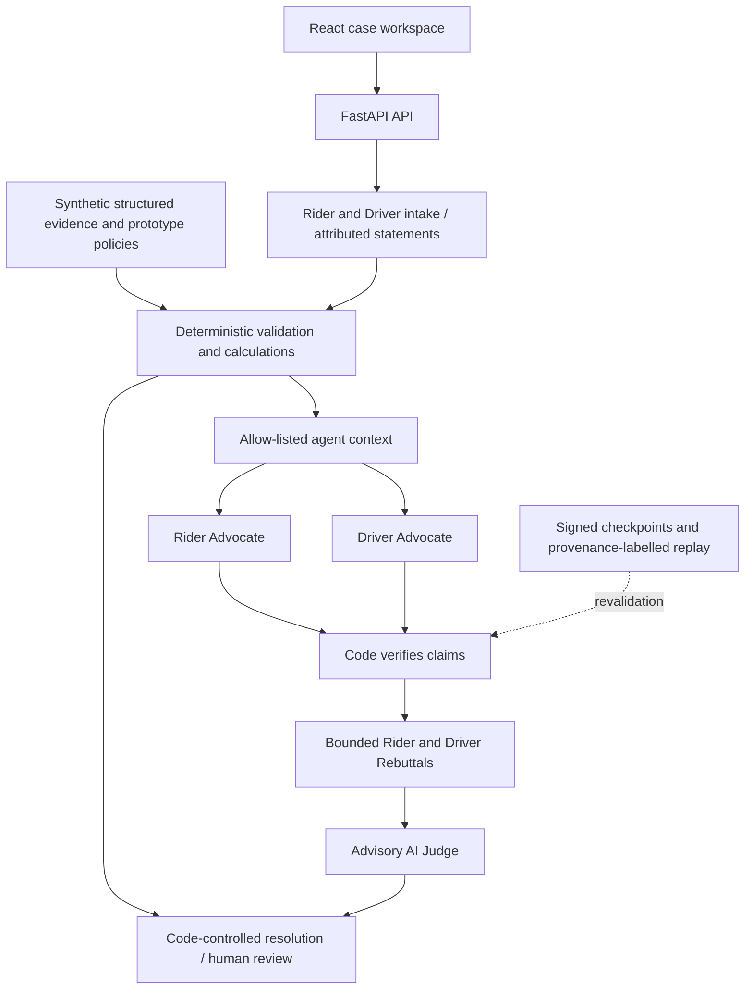

# RydeResolve

An evidence-driven dispute resolution prototype for ride-hailing route-deviation and
no-show-cancellation disputes.

**Digital Native - Ryde / Tencent Cloud AI CAN DO IT Hackathon Singapore 2026.**

Submission blurb: **Evidence-driven AI dispute resolution with auditable, code-controlled outcomes.**

Submission requirements, limitations, Git plan and manual Opera checklist: [Phase 5B readiness](docs/phase5b-submission-readiness.md). Short rehearsal: [three-minute script](docs/phase5b-demo-script.md). Public deployment is not yet available.

## ⚠️ Two implementations exist in this repository

This repository contains **two separate implementations**. Only one of them is the
running application. Please read this before exploring the code.

### 1. The active application — `backend/` + `frontend/`

**This is the running product.** Use it.

| Path | Role |
| --- | --- |
| `backend/` | FastAPI backend. Deterministic analysis engine, evidence validation, case replay, and the Stage 4 Rider + Driver advocate agents. |
| `frontend/` | React + TypeScript case workspace UI. Talks to the backend over HTTP. |

Start it with `start-backend.bat` and `start-frontend.bat`, or see
[`RUNNING.md`](./RUNNING.md) for the full instructions, URLs, and test commands.

### 2. The legacy Node pipeline — `src/`, `test/`, `policies/`, `examples/`

> **LEGACY IMPLEMENTATION — NOT USED BY THE RUNNING REACT + FASTAPI APPLICATION.
> THE ACTIVE BACKEND IS `backend/`.**

The root-level Node.js code (`src/advocates.js`, `src/judge.js`, `src/pipeline.js`,
and friends) was the original end-to-end spike. It is **retained for reference only**
and is deliberately **not** wired into the running application.

It is **frozen**: not integrated, not extended, and not deleted. Its tests still run
via `npm test` at the repository root, but passing them says nothing about the
behaviour of the active application. Do not add features here; make changes in
`backend/` instead.

## Architecture principle

The whole system is built around one rule:

> **CODE calculates facts. AI argues from facts. CODE checks AI claims.
> The Judge decides later, using only verified information.**

In practice this means:

- The deterministic engine is the single source of truth for distances, durations,
  pickup checks, waiting duration, fares, refunds, policy thresholds, evidence
  validity, confidence, and escalation.
- Advocates receive a deliberately restricted, allow-listed view of the case
  (facts, evidence, policy, policy evaluation). They never receive the
  recommendation, the refund amount, confidence, or the resolution mode, and they
  cannot recompute anything because the raw calculation inputs are never exposed.
- Every claim an advocate makes is verified deterministically before it is used.
  Rejected claims are never repaired, rewritten, or dropped — they stay visible for
  audit.
- The full pipeline runs both Advocates, both Rebuttals and the advisory Judge.
  Code validates the Judge's permitted verified-information projection and retains
  exclusive control of refunds and human-review escalation.

For the prepared single-host HTTPS deployment, persistent storage, safe offline
demo initialization and rollback procedure, see [deployment preparation](docs/phase5a-deployment.md).

## Quick start

### First-time setup

Create a virtual environment, install the backend and frontend dependencies, and
copy `backend/.env.example` to the gitignored `backend/.env`. For live Gemini use,
set `AGENT_MODE=real`, `AGENT_PROVIDER=gemini_native`, `AGENT_MODEL`, and
`AGENT_API_KEY`. Never commit the credential. Intake stays unavailable in mock mode;
the deterministic product and offline agent tests remain usable.

### Install dependencies (Python 3.13 / Node 24)

```powershell
python -m venv backend/.venv
backend/.venv/Scripts/python.exe -m pip install -r backend/requirements.txt
cd frontend
npm ci
cd ..
```

On Linux/macOS use `backend/.venv/bin/python` instead of the Windows executable.
For container runtime dependencies, the Docker build uses `backend/requirements.lock`.
On a fresh development checkout only, copy `backend/.env.example` to `backend/.env`;
never overwrite an existing configured environment. Keep the supplied mock defaults
for offline operation. See Phase 5B for the distinction between mock resolution
and live AI Intake.

### Run the backend (Terminal 1)

```bash
cd backend
.venv\Scripts\python.exe -m uvicorn app.main:app --host 127.0.0.1 --port 8000
```

### Run the frontend (Terminal 2)

```bash
cd frontend
npm run dev
```

### Open the app

Go to `http://localhost:5173`

All AI roles use the provider registry and the same `AGENT_*` configuration.
`AGENT_API_KEY` is read from `backend/.env` locally or the server environment in
production. See
[`RUNNING.md`](./RUNNING.md) for troubleshooting and deployment notes.

## Tests

```bash
cd backend && python -m pytest       # active application
npm test                             # LEGACY Node pipeline only
cd frontend && npm run build         # type-check + production build
```

## Architecture for reviewers



The prototype uses synthetic cases and prototype policies, not real Ryde data or
financial execution. MOCK_DEMO replay does not prove a live Gemini run or completed
AI Intake conversation. It recomputes the final decision and rechecks saved claims.

For reproducible offline initialization without copying private databases, use
the guarded `mock-demo --initialize-empty-intake` procedure in
[deployment preparation](docs/phase5a-deployment.md). It requires fresh storage and
refuses populated/unrecognized databases and existing artifact directories.
